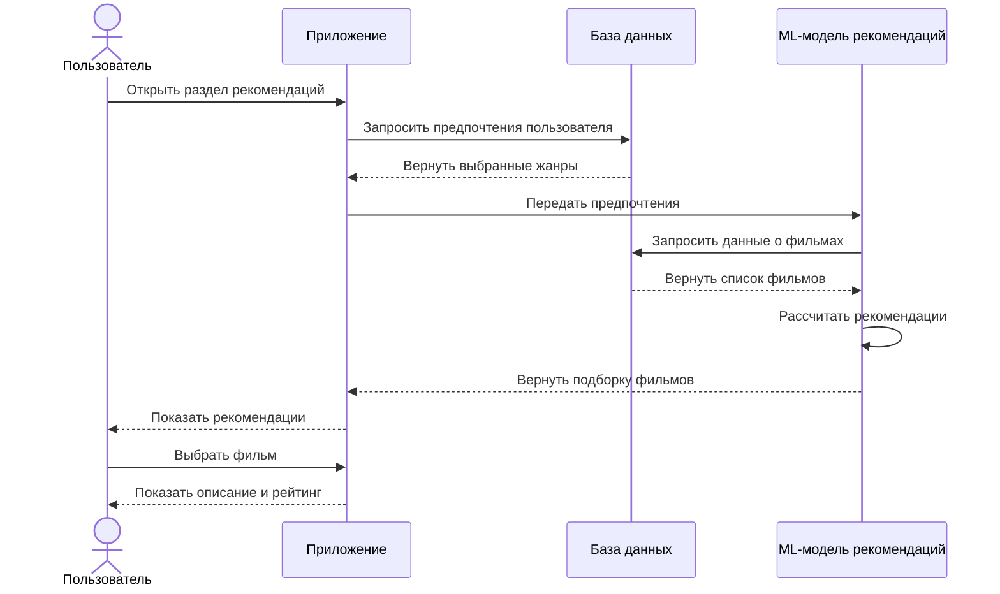
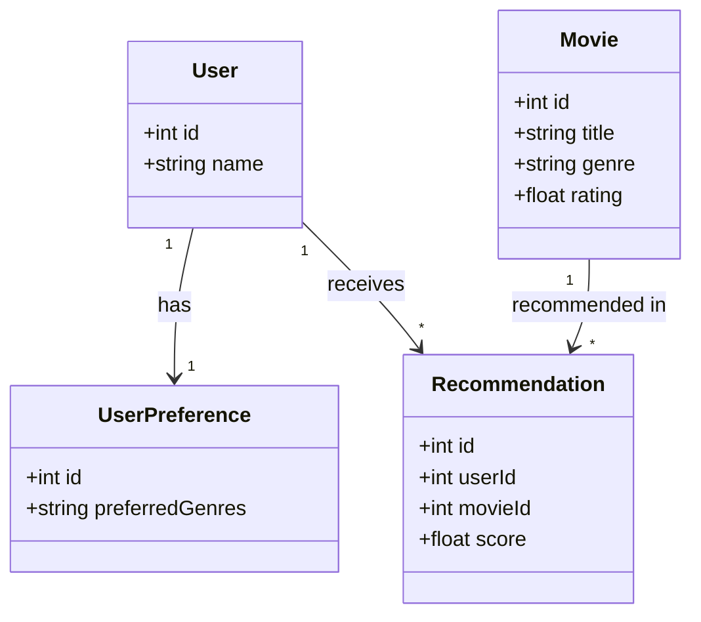

# Диаграммы

## Диаграмма последовательности

## Диаграмма классов

- User — хранит информацию о пользователе системы.
- Movie — содержит данные о фильме: название, жанр и рейтинг.
- UserPreference — хранит предпочтения пользователя по жанрам.
- Recommendation — связывает пользователя с рекомендованным фильмом и содержит оценку его соответствия предпочтениям.